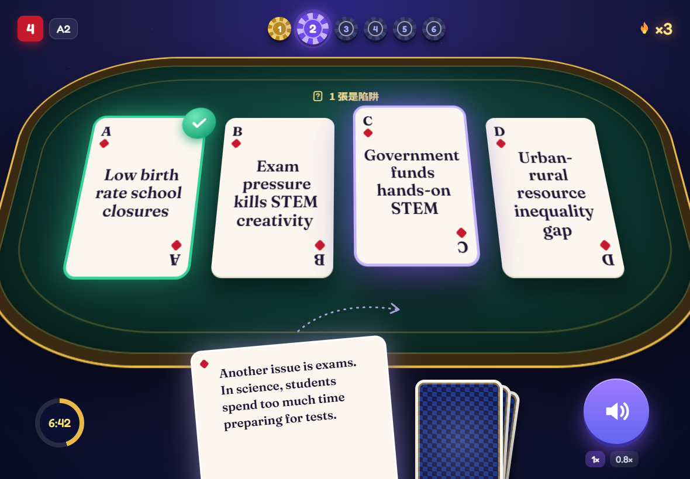
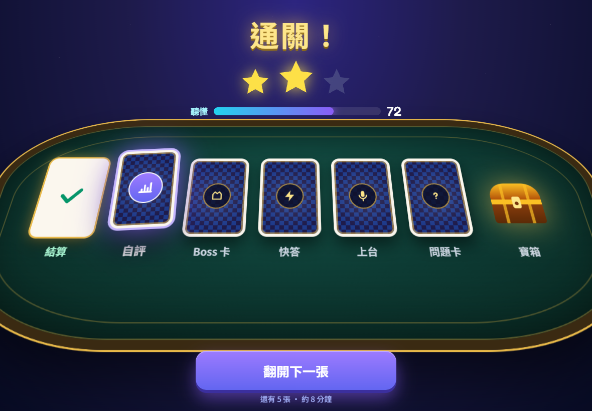
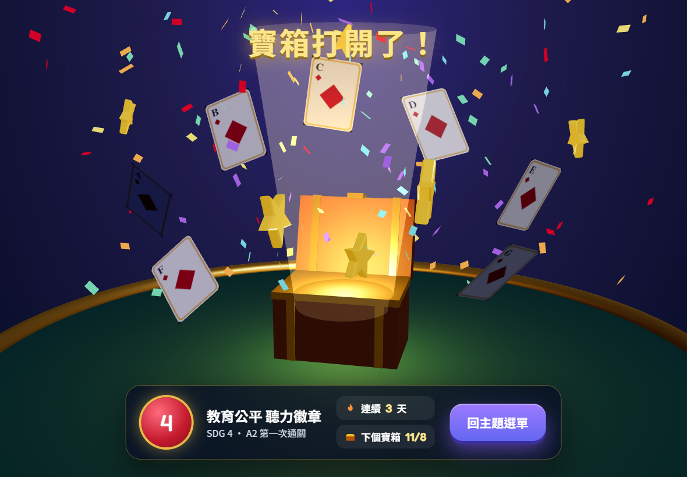

# Pecha Kucha Card Game 學習設計、KPI 與成效驗證計畫

> 來源：Claude Docs「Pecha Kucha Card Game 學習設計、KPI 與成效驗證計畫」（陳洺安，2026-11-06 核准，11-08 加上「全域個人籌碼」一節）。
> 這是給公司端與 AI 協作用的 GitHub 版本；原 Claude Docs 只有使用者本人能開，之後以本檔為準。
> 文中 §1–§7 依章節順序：現況與問題＝§1、新遊戲流程＝§2、KPI＝§3、資料規則＝§4、成效驗證＝§5、錄音隱私＝§6、實作分期＝§7。


2026-11-06 · 陳洺安

## 結論

Card Game（`pecha_kucha_builder`）改為唯一的卡牌遊戲，舊的 SDGs Pecha Kucha 入口導向它。收尾從一個「全部完成」視窗，改成 7 步的學習收尾：先確認完成、自評信心，再重練錯句、小測、朗讀錄音、反思，最後給下一步。每一次配對、重聽、作答、錄音都記進現有的學習數據後台（教師分析頁、異常偵測、Excel），不另建一套資料庫。

成效的證據鏈是：遊戲內的「第一次就配對」正確率隨練習上升，這個指標能預測遊戲外的前後測進步，而且進步在 2–4 週後還留得住。三個環節都要從上線第一天就記對資料，所以 §4 的欄位要先定案。主指標已依「卡權重」扣除猜測機率：不扣的話，亂猜就有 57–75%（§3）。

2026-11-06 已核准：遊戲設計（§2，含干擾卡與 30 秒雜湊片段）、KPI（§3）、成效驗證（§5，主題 4-1 與 13-1）、實作順序與錄音保存一學期＋ 30 天（§7，第 5 期為「貼講稿自動切投影片」工具）。核准前的審核清單：

1. §2 的 7 步收尾是否太長。每步約 1–2 分鐘，全部約 10 分鐘；可以拿掉的是第 6 步反思。
2. §3 的 KPI 清單，表格中「核定」欄可以直接選。
3. §5 的研究設計要用哪一種：同班交叉（推薦）或兩班對照。
4. §6 錄音上傳的保存期限（預設一學期＋30 天）。

## 現況與問題

遊戲本體可以玩完。我在本機用自動腳本完整玩了 4-1 A2 的 6 段，沒有卡住，也沒有版面超出。問題集中在兩個地方：收尾太薄，以及數據不完整、不可信。

現在的收尾只有一個視窗，顯示總時間、錯誤數、段數。學生不知道自己錯在哪一句，不會再練一次，也沒有「下一步做什麼」。另一個入口 SDGs Pecha Kucha 的收尾頁（finish）比較多內容，但克漏字寫死成 SDG 4 的單字，錄音和作答也都沒存。

| # | 問題 | 影響 | 處理 |
| --- | --- | --- | --- |
| 1 | SDGs Pecha Kucha 的題庫在正式站是空的：SDG 4、5、13 各難度 0 張卡，9-1 A1 只有第 1 段有 2 張 | 學生選什麼都玩到 SDG 4 示範卡，成績却記在他選的主題；9-1 A1 卡在空段落，無法結束 | 入口導向 Card Game |
| 2 | Card Game 成績在背景送出，失敗就消失 | 網路不穩時成績遺失 | 先存本機待送佇列，重試到成功，學生看得到「已儲存」 |
| 3 | `/game/pk-result` 不登入也能送，名字可以自己填 | 可以用別人的名字灌假成績 | 登入才記名，未登入一律記為 anonymous |
| 4 | 學習數據 API 不帶登入也能寫進別人的紀錄 | 資料可被端改 | 有主人的紀錄只有本人能寫 |
| 5 | 學習數據在 PostgreSQL 上，一批裡只要有一筆重複，前面的也一起丟掉 | 正式站默默少資料 | 改用「重複就跳過」的寫法 |
| 6 | 只記每段錯誤總數，沒記哪一句被配到哪張錯的卡 | 老師看不出學生卡在哪裡，也算不出題目難度 | 每次配對都記一筆事件（§4） |

## 新遊戲流程

**核心是一篇演講稿**。老師提供的永遠是一篇完整講稿，Pecha Kucha 只是把它切小來練：講稿 → 句子 → 投影片（20 張）→ 配對卡與 30 秒口說片段。所有東西都從同一篇講稿切出，最小單位是「句子」，每句有固定編號。這樣老師換一篇講稿，卡片、小測、口說片段都能自動重新產生，數據也能追回到「哪一句」。

一局分三段：開局先知道目標，遊戲中維持現在的配對玩法，收尾把「聽懂」接到「能講」。下一局開局會自動混入上次錯的句子，形成間隔複習的循環。

**整局上限 30 分鐘**。預估一般學生 20–26 分鐘，留 4 分鐘緩衝：

| 階段 | 預估 | 最多 | 控制時間的做法 |
| --- | --- | --- | --- |
| 開局 | 1 分 | 2 分 | 任務卡可略過 |
| 遊戲中（20 張卡） | 10–13 分 | 15 分 | 朗讀本身約 7 分鐘，無法壓縮；重聽不限但計入時間 |
| 收尾 1–2 完成確認、自評 | 1 分 | 1 分 |  |
| 收尾 3 錯句重練 | 1–2 分 | 3 分 | 最多 5 句，全對就跳過 |
| 收尾 4 小測 | 2 分 | 2 分 | 固定 5 題 |
| 收尾 5 朗讀錄音 | 2–3 分 | 4 分 | 一個 30 秒片段，試念＋正式錄一次，最多重錄 2 次；整篇 6 分 40 秒改放在「下次挑戰」，不在這一局 |
| 收尾 6–7 反思、下一步 | 2 分 | 3 分 | 反思只有 1 題＋一句 |

如果遊戲中已經超過 20 分鐘，收尾會自動變成短版：只留完成確認、錯句重練、下一步，小測和錄音留到下次開局。

**開局（約 1 分鐘）**

1. **任務卡**：這場演講的主張（中英）＋ 6 段結構＋今天的目標「聽懂 20 張投影片，最後自己念一段」。依據：Hattie & Timperley 的 Feed Up；Vandergrift 的聽力「預測」策略。
2. **上次的錯句**：如果學生以前玩過這個主題，先提示「這次會再出現 3 句你上次配錯的」。依據：間隔練習（Cepeda 2006）。

**遊戲中（現有玩法，約 5–8 分鐘）**

3. 聽句子、拖到投影片標題卡，玩法不變，但每段桌上多放 1 張干擾卡：同一主題其他段落的投影片標題，沒有句子屬於它。這樣最後一張也要聽懂才放得對，學生也順便辨認「這句屬不屬於這一段」。另一個新增是「每段完成後的 5 秒小結」：這段在演講裡的功能（例如「提出問題」）。每次配對、重聽都記一筆事件。

**收尾（約 10 分鐘，7 步）**

1. **完成確認，不排名**：三個數字（聽懂分數（扣除猜測的首次得分，換成 0–100）、總時間、重聽次數）＋ 6 段熱度條，顯示「成績已儲存」。依據：Kluger & DeNisi 1996，針對「自我」的回饋（排名）有三分之一反而讓表現變差。
2. **每段自評信心**：看錯句之前，為 6 段各點一個信心（1–4）。依據：後設認知與信心校準（Ross 1998）；也是§3 校準指標的資料來源。
3. **錯句重練**：只出「第一次配錯」的句子，可重聽原音，配對到全對為止；配對後顯示「你上次放到的是哪張卡」。依據：Butler & Roediger 2008，選擇題後沒有矯正回饋，學生會記住錯的配對；產品上 Quizlet Learn、Kahoot 的「重做錯題」都是這個做法。全對的學生跳過這步。
4. **小測 5 題**：題型和遊戲不同：聽一句話填關鍵字，字取自該投影片的關鍵字，優先出學生錯過的句子。作答前點信心，作答後立即給答案。依據：提取練習（Roediger & Karpicke 2006；Adesope 2017 統合分析）。
5. **朗讀錄音**：每位學生念一個約 30 秒的片段。片段以句子為單位從講稿切出，依該級語速念起來 25–35 秒，由伺服器依雜湊分配（§4 第 9 條），同班相鄰的人拿到不同片段。念完立即看到：片段是否在目標時間內、語速（字/分）、Chrome 上另加「機器聽到的字」。可以試聽、重錄，按「送出給老師」才上傳。依據：Microsoft Speaker Coach、Reading Progress 的即時回饋與重練循環。
6. **反思 1 題＋一句英文**：聽力策略題從 MALQ 五個面向輪流出 1 題（例如「聽不懂時你怎麼辦？」）；再用一句英文把這個 SDG 連到自己的生活。依據：Vandergrift & Goh 2012；低程度學生從這類反思獲益最多（Vandergrift & Tafaghodtari 2010）。
7. **下一步**：個人複習清單（錯句＋小測錯字）、建議 2–3 天後回來、個人最佳紀錄、全班分布圖（匿名，取代排名）。依據：Feed Forward；間隔練習。

訪客模式走同樣 7 步，但不上傳任何東西。3D Harbor 嵌入時只走第 1–3 步，然後回到 3D 遊戲。

## 畫面設計（請逐張審核）

畫面照現在遊戲的「Pro Poker Edition」延伸成「星夜牌桌」：夜空、墨綠絨布牌桌加金邊、象牙白撲克牌、紫色按鈕。每個畫面最多一句話，好玩主要靠動畫和 3D。下面先放平板版的 3 張；方向核准後，每個畫面會補齊平板、手機、電腦三種尺寸，重要的動畫畫成 3 格分鏡。

### 配對桌面



3D 傾斜的牌桌上，標題卡像真的撲克牌，有 A–D 牌角和 SDG 4 的紅色記號。手上的牌在下方，用拇指往上拖；上方的籌碼是 6 段進度，右上是連擊火焰。

### 收尾：翻開 7 張牌



收尾 7 步變成桌上 7 張蓋著的牌，每翻一張就是一關，最後一格是寶箱。星星和「聽懂」能量條取代原本的分數表。

### 通關：3D 寶箱



這張用 three.js 畫成真的 3D 畫面，和 3D Harbor 用的是同一套技術：寶箱打開、7 張牌飛出來、星星和彩帶。下方只留徽章、連續天數和下一個寶箱的日期。

### 方向審核

| 畫面 | 你的決定 |
| --- | --- |
| 配對桌面 |  |
| 翻開 7 張牌 |  |
| 3D 寶箱 |  |

## 數據收集 KPI（請審核）

主指標只有一個：**首次正確率**。其他指標用來解釋它（過程）、延伸它（口說、後設認知）、或確保它可信（題目品質、資料品質）。重聽次數一律中性呈現，它是聽力策略，不是扣分項。異常指標只標記給老師看，不自動判作弊。

**卡權重：主指標要扣掉猜測機率**。每段最後一張只剩一個位置，一定對；倒數第二張也有一半機率猜對。照原本的算法，完全不聽、亂猜也能拿到很高的「首次正確率」：

| 主題（每段卡數） | 一定對的卡 | 亂猜的首次正確率：現在 | 每段加 1 張干擾卡 | 每段加 2 張干擾卡 |
| --- | --- | --- | --- | --- |
| 4-1 等 20 張主題（3,3,3,3,4,4） | 6 / 20 | 57.5% | 34.5% | 25.2% |
| 9-1 等 12 張主題（每段 2） | 6 / 12 | 75.0% | 41.7% | 29.2% |

所以做兩件事。第一，每次配對記下當下剩幾個可選位置 k，用「扣除猜測的得分」計算，剩 1 個位置的卡不列入。每張卡的得分為（x = 1 代表第一次就對）：

```latex
s = \frac{x - 1/k}{1 - 1/k}, \qquad k \ge 2
```

一局的主指標是各張 s 的平均。亂猜的期望值是 0，全對是 1，不同主題、不同段落大小可以直接比較。第二，遊戲本身每段加 1 張干擾卡（§2），讓最後一張也要聽懂才放得對；錯誤次數也除以該張最多可能錯的次數（k − 1）來比較。

| 層級 | 指標 | 定義與算法 | 老師怎麼用 | 核定 |
| --- | --- | --- | --- | --- |
| 學習成果 | 1 首次正確率（主指標） | 依卡權重扣除猜測的首次得分 s 的平均（上方公式）；每局、每段各算一個 | 看誰聽不懂、哪一段最難 | 採用 |
| 學習成果 | 2 練習曲線 | 同一位學生同一主題第 1、2、3 局的首次正確率變化 | 看多練有沒有用 | 採用 |
| 學習成果 | 3 延宕保留 | 上次配錯的卡，在下一局的首次正確率 | 看是真的學會還是當下記住 | 採用 |
| 學習成果 | 4 小測得分 | 收尾 5 題答對數，另存每題的答案 | 關鍵字掌握度 | 採用 |
| 學習成果 | 5 重練到精熟的次數 | 錯句重練時，每句要配幾次才對 | 找出「練了還是不會」的句子 | 採用 |
| 學習過程 | 6 重聽次數 | 每張卡按 Repeat 的次數 | 看哪句聽力負擔最重 | 採用 |
| 學習過程 | 7 反應時間中位數 | 朗讀結束到放下卡的秒數，取中位數 | 聽力流暢度 | 採用 |
| 學習過程 | 8 有效學習時間 | 事件間隔超過 90 秒的部分不計 | 排除掛機時間，作為「劑量」 | 採用 |
| 學習過程 | 9 完成率與放棄點 | 開始的局中走完收尾的比例；中斷在哪一段、哪一步 | 找出流程中最多人放棄的地方 | 採用 |
| 口說 | 10 錄音送出率 | 完成的局中有送出錄音的比例 | 口說練習的參與度 | 採用 |
| 口說 | 11 時間達標 | 片段實際朗讀時間 ÷ 該級語速下的目標時間；0.85–1.15 算達標 | Pecha Kucha 節奏掌握 | 採用 |
| 口說 | 12 語速 | 講稿字數 ÷ 發聲時間（字/分） | 太快或太慢 | 採用 |
| 口說 | 13 機器聽到的比例 | Chrome/Edge 語音辨識聽到的關鍵字 ÷ 關鍵字數；只供參考不計分 | 搭配聽錄音判斷 | 採用 |
| 後設認知 | 14 信心校準偏差 | 平均信心（換算成 %）− 實際首次正確率；正值代表高估自己 | 找出「以為自己懂」的學生 | 採用 |
| 後設認知 | 15 反思完成率 | 有填反思題與英文句的比例與字數 | 討論課的素材 | 採用 |
| 持續使用 | 16 7 天回訪率 | 完成一局後 7 天內再玩的學生比例；另記每週局數 | 學生是否自動回來練 | 採用 |
| 題目品質 | 17 題目難度 p 值 | 每張卡全班的首次得分 s，只算剩 2 個以上選項時的作答 | 找全班都難的句子重教 | 採用 |
| 題目品質 | 18 鑑別度 | 總分前 27% 與後 27% 學生的 p 值差；接近 0 或負值代表題目或音檔有問題 | 檢查題庫 | 採用 |
| 題目品質 | 19 混淆對 | 「正確卡 → 被誤放的卡」出現次數，取前幾名 | 診斷學生把什麼跟什麼搞混 | 採用 |
| 資料品質 | 20 異常學生（離群值） | 同主題同難度同學間比較 5 個特徵（反應時間扣該卡中位數、得分 s、重聽、錯誤率、整局時間）的穩健 z（中位數與 MAD），\|z\| ≥ 3.5 為離群；高分且極快同時成立為高度異常。同組不到 20 局時先用反應 < 1.5 秒並標「暫定」 | 看哪個特徵、偏離全班多少；按「確認正常／異常」校準門檻，系統不自動判作弊。研究排除規則與 3D 遊戲的星數異常也用這套 | 應該用OUTILER去抓異常學生 |
| 資料品質 | 21 亂試型樣 | 同一句 10 秒內連續配錯 3 次以上 | 標記「靠試錯過關」，由老師判斷 | 採用 |

## 現在就要定好的資料規則

統計做不出來，多半是因為當初沒記到，事後補不回來。下面 8 條從第一版就做進去，之後不要再改格式。

1. **題目要有穩定編號**：講稿的每一句有固定編號，投影片、卡片、片段都記「由哪幾句組成」；每張卡用「主題-難度-投影片編號」，例如 `4-1/A2/s07`。另存題庫版本號；改了句子就是新版本，新舊版的數據不混在一起算。
2. **每次配對都記一筆事件**：該張卡、放到哪張、對不對、是不是第一次、當下剩幾個可選位置（k，含干擾卡）、重聽幾次、朗讀結束後幾毫秒放下。「第一次對」和「最後對」分開存。
3. **事件格式對齊國際標準**：沿用現有的 learning\_events 表，欄位對應 xAPI Serious Games Profile（誰、做了什麼、對什麼、結果、時間），之後要換平台或給外部研究者都能轉換。
4. **學生用假名編號**：分析資料只放假名 ID，姓名與 ID 的對照表另外保存。匯出給外部專家時不含個資。
5. **班級與分組欄位**：學生帳號加「班級」與「研究分組」（例如先玩 SDG 4 或先玩 SDG 13）。沒有這兩欄，§5 的對照設計就無法分析。
6. **研究同意標記**：每位學生記「是否同意資料用於研究」與「是否同意上傳錄音」，分開存。沒同意的學生一樣可以玩，只是不進研究資料集。
7. **置入前後測**：遊戲裡留一個「前測／後測」入口，老師可以在指定日期開放。題目是平行的 A、B 兩卷，前測用哪一卷隨機分配。
8. **異常規則先寫死**：哪些局會從分析中排除（例如快速猜測率超過 50%），在收資料之前就寫進研究計畫。事後才決定排除哪些人，專家會質疑是挑過的結果。

9) **口說片段先切好、由伺服器分配**：
   - 每個主題、難度預先切成不重疊的 30 秒片段：20 張的主題約 14 段，12 張的約 8 段。片段編號跟題庫版本綁在一起，例如 `4-1/A2/v3/c07`。
   - 每段先算字數、難字比例、數字個數，只保留難度在同一範圍內的片段。
   - 分配：以 SHA-256（學生 ID｜主題｜難度｜學期鹽值）把全班排出打亂的順序，再依序輪流分配片段。同一位學生每次拿到同一段，重錄才能比較進步；各段人數最多相差 1 人。一班 40 人時每段約 3 人，無法每人都不同。
   - 分配在伺服器上做並記錄下來，學生改網址換不到別段。每學期換一次鹽值。
   - 統計時把片段編號當成隨機效果，避免「抽到難的就吃虧」。

## 成效驗證計畫

建議用**同班交叉設計**：同一個班兩個 SDG 主題，一個用遊戲學、一個用一般講稿閱讀學，半學期後互換。每位學生都是自己的對照組，沒有「另一班本來就比較強」的質疑，也沒有「只有一半學生玩得到」的公平問題。兩個班的主題順序相反，以抵銷主題難易差。一個學期、兩個班、約 60–80 位學生就夠。

**樣本數**：預期效果量 d = 0.5、α = .05、檢定力 .80 時，同一人前後比較需要約 34 人；兩組各自独立比較則每組需要 64 人。這是建議交叉設計的主要原因。加上 20% 流失，至少收 42 位同意的學生。

**測量工具**

| 測什麼 | 工具 | 時點 |
| --- | --- | --- |
| 主題聽力理解 | 自編 A/B 平行卷，每主題 15 題，先試測信度（α ≥ .70） | 前測、後測、延宕 3 週 |
| 關鍵字彙 | 聽寫與填空 10 題 | 同上 |
| 口說 | 每人一段 Pecha Kucha 展演，兩位不知道組別的評分者用同一份 rubric；評分者一致性 ICC ≥ .75 | 後測 |
| 聽力後設認知 | MALQ 問卷（21 題） | 學期初、學期末 |
| 動機與可用性 | IMI 短版、SUS | 學期末 |
| 遊戲內過程 | §3 的 KPI，自動紀錄 | 全程 |

**要驗證的假設與統計方法**

| 假設 | 方法 | 對專家說明什麼 |
| --- | --- | --- |
| H1 用遊戲學的主題，後測進步比一般學的主題大 | 線性混合模型：成績 \~ 教法 × 時點，學生與主題為隨機效果；報告 Hedges g 與 95% 信賴區間 | 遊戲本身有效，不是多練就會進步 |
| H2 多玩幾局，首次正確率穩定上升 | 邏輯混合模型：第一次對 \~ 第幾局＋剩餘選項數 k，學生與題目為隨機效果；剩 1 個選項的配對不列入 | 遊戲中的學習是真的發生了 |
| H3 遊戲內首次正確率能預測外部後測 | 控制前測的迴歸，報告相關與信賴區間 | 遊戲內的指標可信，老師可以拿來判斷學生 |
| H4 遊戲組的進步 3 週後還留著 | 延宕測與後測的差在兩種教法間比較 | 不是短期記憶 |
| H5 練得越多進步越多 | 有效學習時間與進步幅度的關係，控制前測 | 劑量反應，因果說服力最強的證據之一 |
| H6 學生越會判斷自己懂不懂 | MALQ 前後測；信心校準偏差隨局數縮小 | 學到的是可轉移的聽力策略 |

**讓結果經得起專家審查**：收資料前在 OSF 預先登記假設與排除規則；通過學校研究倫理審查；報告效果量而不只是 p 值；用 CONSORT 流程圖列出每個階段的人數與流失。參照基準：Wouters et al. 2013 的統合分析，嚴肅遊戲相較傳統教學的學習效果量約 0.29；超過這個數字就是「優於一般教育遊戲」。

**一個要先說明的限制**：遊戲訓練的是「這份講稿」的聽力，後測若用同一份講稿會高估效果。所以後測需要同主題但不同句子的題目，才算「學會聽這個主題」。另外加一份通用聽力測驗做遠遷移，不預期一學期內會有顯著差異，但專家會問。另一個缺口反而是亮點：研究助理沒有找到「把 Pecha Kucha 演講當聽力材料」的研究，這可以是本專案的研究貢獻。

## 錄音上傳的同意與隱私

錄音會上傳，但預設「練習留在本機，學生按下送出才上傳」。沒有同意紀錄的學生一樣能完成整局，只是不上傳。以下不是法律意見，正式使用前請學校法務或個資窗口確認。

- **學期初書面告知**：依個資法第 8 條寫明六項（蒐集者名稱、目的、資料類別、期間地區對象方式、當事人權利、不提供的影響）。未滿 18 歲的學生由法定代理人同意。「研究用途」與「錄音上傳」分開勾選。
- **第一次開麥克風前的即時告知**：白話說明只給任課老師聽、不公開、不用來訓練 AI、保存到何時、不送出也能完成遊戲。也要寫明 Chrome 的語音辨識會把聲音送到 Google 處理。
- **只上傳必要資料**：音檔、每張的時間戳與 §3 的口說指標；檔名不含姓名。不做聲紋辨識。
- **只有任課老師能聽**：後台每段錄音標示「未聽／已回饋／請重錄」。
- **保存期限**：預設「一學期＋ 30 天」，到期自動刪除；到期前提供老師批次匯出。Flip 在 2024 年停用時，很多老師來不及匯出就全部過期了，是反面教材。
- **存在哪裡**：音檔放在 VM 的磁碟（目前剩 71 GB），資料庫只存路徑。一段 1 分鐘的壓縮錄音約 0.5 MB，一學期 200 位學生各 10 段約 1 GB。由於 VM 所在的網路屬於學術網路，請先向學校確認可以存放學生錄音。

## 全域個人籌碼

每位學生一個籌碼帳戶，跨所有遊戲累積（Card Game、3D Harbor、SDG 4 Stage），換過課程、換過裝置都是同一個餘額。籌碼只獎勵 §3 想看到的學習行為，不獎勵猜、不獎勵速度，也不做排名；只能換外觀，不能換學習內容或分數。

**和牌桌上的籌碼分開**：配對桌面上方那排 1–6 號籌碼是「這一局的段落進度」，不是錢包。錢包放在左上角，一疊金色籌碼加數字，收尾翻牌和寶箱時才有籌碼飛進錢包的動畫。

**怎麼賺**（伺服器在每局結束時依事件計算，前端送來的數字一律不採用）

| 行為 | 籌碼 | 對應 | 為什麼這樣給 |
| --- | --- | --- | --- |
| 聽懂分數（扣除猜測的首次得分 s，換成 0–100） | 分數 ÷ 10，四捨五入，最多 10 | KPI 1 | 亂猜的期望值是 0 籌碼，猜不出籌碼 |
| 走完一局（含收尾） | 5 | KPI 9 | 鼓勵走完，而不是只玩配對 |
| 錯句重練全部配對正確 | 3 | KPI 5 | 獎勵改正錯誤 |
| 小測每答對 1 題 | 1（最多 5） | KPI 4 |  |
| 完成朗讀步驟 | 3 | KPI 10 | 在本機錄完就給，不論有沒有送出；不能用籌碼換學生同意上傳 |
| 寫完反思題與英文句 | 2 | KPI 15 |  |
| 間隔回訪：同主題距上一局 2 天以上再玩 | 5 | KPI 16、間隔練習 | 鼓勵隔天回來，而不是同一天連刷 |
| 3D Harbor 每顆星 | 1 | 3D 星數 |  |
| SDG 4 Stage 完成正式模式 | 5 |  |  |
| 老師加發或扣回 | 任意，要填理由 |  | 課堂活動、更正錯誤 |

重聽永遠不扣籌碼（重聽是聽力策略，§3）。沒有連擊加成：連擊火焰只是畫面效果，不換籌碼，因為連擊會鼓勵學生跳過重聽搶快。

**防刷規則**

1. **每日上限 60 枚**（約兩局完整的量），超過的部分不入帳，收尾畫面直接說「今天的籌碼已滿，明天再來」。
2. **同一主題同一難度一天第 3 局起，只給聽懂分數那一項**，走完、回訪等固定獎勵不再給。
3. **被標記異常的局先暫緩入帳**：KPI 20 高度異常、KPI 21 亂試型樣的局，籌碼記為「待確認」，老師在後台按「確認正常」才入帳，按「異常」就作廢。學生看到的是「這局的籌碼等老師確認」。
4. **訪客只在本機顯示**，不入帳，登入後也不會轉入。

**怎麼花**：只換外觀，不影響學習內容與數據。牌背圖案、牌桌絨布顏色、寶箱外觀、3D Harbor 角色配件。不賣提示、不賣重聽、不解鎖主題或難度，避免籌碼多的學生在 §5 的比較裡多一項優勢。

**全班合作目標，取代排名**：延續「排行榜預設關、用合作量表」的決定，每班每週有一個籌碼目標（例如全班合計 1,500 枚），達標整班解鎖一款新牌背。只顯示全班合計和進度條，不顯示誰賺最多。

**資料表：用流水帳，不直接改餘額**

| 欄位 | 說明 |
| --- | --- |
| `id` | 流水號 |
| `user_id` | 學生 |
| `delta` | 加減多少（扣回用負數） |
| `reason` | 規則代碼，例如 `pk.score`、`pk.finish`、`spaced.return`、`teacher.grant` |
| `game`、`run_id` | 哪個遊戲、哪一局 |
| `course_id` | 當時的課程，可以按課程看，但餘額是全域的 |
| `status` | `posted`（入帳）、`held`（待確認）、`void`（作廢） |
| `rule_version` | 規則版本；改規則時舊紀錄不重算 |
| `idempotency_key` | 例如 `run:812:pk.finish`，同一局同一規則只入帳一次，網路重送也不會重複 |
| `by_user`、`note` | 老師手動調整時記誰、為什麼 |
| `created_at` | 時間 |

餘額 = `posted` 的加總，另存一份快取供首頁顯示，每晚用流水帳對帳一次。購買外觀也是一筆負的流水帳，購買紀錄另存 `chip_items`（學生、物品、購買時間）。

**研究上要注意**：籌碼本身是一種動機介入。§5 的交叉設計中，遊戲組有籌碼、一般講稿組沒有，所以「遊戲的效果」包含籌碼，報告時要寫明。籌碼流水帳也是資料：每位學生的籌碼來源比例（聽懂、走完、回訪）可以和 KPI 16 回訪率一起看，檢查籌碼有沒有把學生推向我們想要的行為。

**放進分期**：流水帳資料表和伺服器計算放第 1 期（和配對事件同時上線，籌碼才能從第一天就對得上事件）；錢包畫面、收尾飛籌碼動畫放第 2 期；暫緩入帳的老師確認、手動加扣、全班目標放第 3 期；商店與外觀放第 3 期之後。

待你決定：

- [ ] 每日上限 60 枚是否合適
- [ ] 全班每週目標的數字與獎勵
- [ ] 第一批可以換的外觀（建議 4 款牌背、3 種牌桌顏色）

## 實作分期與待決事項

分四期。每期都在功能分支完成，用自動試玩腳本跑過 5 種螢幕尺寸、你實機驗收後才合併到 `main`。

1. **修 bug 與資料可信**：§1 的 6 項；SDGs Pecha Kucha 入口導向 Card Game；每次配對記事件；成績待送佇列與「已儲存」提示。
2. **新收尾**：§2 的 7 步與 30 分鐘預算、間隔複習的錯句混入。錄音先只存本機。
3. **錄音上傳與老師後台**：同意流程、音檔存 VM、老師聽錄音與回饋、§3 的題目品質與需要幫助名單、Excel 匯出。
4. **研究模式**：班級與分組欄位、前後測入口、假名匯出。

VM 鏡像站與上面並行：你在 GoDaddy 加好 `vm` 的 A 記錄後，我建置 `https://vm.cathylanguagehub.com`，每小時同步 GitHub 程式與 Railway 資料。

待你決定：

- [x] §3 KPI 逐項核定
- [x] 研究設計：同班交叉或兩班對照；哪兩個班、哪兩個主題
- [x] 錄音保存期限
- [x] 向學校確認 VM 可以放學生資料與錄音：2026-11-06 學校已確認可以
- [ ] 在 GoDaddy 新增 `vm` 的 A 記錄，指向 140.115.82.165（你回家後新增）
- [ ] 在 VM 上設定 Railway 的 DATABASE\_URL（步驟另外給你）

## 參考資料

由三位研究助理於 2026-11-06 查詢。多數文獻只讀到摘要或二手資料，正式引用前請再核對原文。

**教學法與學習科學**

- Hattie & Timperley (2007). [The power of feedback](https://doi.org/10.3102/003465430298487). *Review of Educational Research, 77*(1), 81–112.
- Kluger & DeNisi (1996). [The effects of feedback interventions on performance](https://cris.huji.ac.il/en/publications/the-effects-of-feedback-interventions-on-performance-a-historical/). *Psychological Bulletin, 119*, 254–284.
- Roediger & Karpicke (2006). [Test-enhanced learning](https://doi.org/10.1111/j.1467-9280.2006.01693.x). *Psychological Science, 17*(3), 249–255.
- Butler & Roediger (2008). Feedback enhances the positive effects and reduces the negative effects of multiple-choice testing. *Memory & Cognition, 36*(3), 604–616.
- Cepeda, Pashler, Vul, Wixted & Rohrer (2006). [Distributed practice in verbal recall tasks](https://pubmed.ncbi.nlm.nih.gov/16719566/). *Psychological Bulletin, 132*(3), 354–380.
- Ross (1998). [Self-assessment in second language testing](https://doi.org/10.1177/026553229801500101). *Language Testing, 15*(1), 1–20.
- Vandergrift, Goh, Mareschal & Tafaghodtari (2006). The Metacognitive Awareness Listening Questionnaire (MALQ). *Language Learning, 56*, 431–462.
- Vandergrift & Tafaghodtari (2010). Teaching L2 learners how to listen does make a difference. *Language Learning*.
- Vandergrift & Goh (2012). *Teaching and Learning Second Language Listening: Metacognition in Action*. Routledge.
- Wouters, van Nimwegen, van Oostendorp & van der Spek (2013). A meta-analysis of the cognitive and motivational effects of serious games. *Journal of Educational Psychology, 105*(2).
- Wise & Kong (2005). Response time effort: A new measure of examinee motivation in computer-based tests. *Applied Measurement in Education, 18*(2).
- Wise (2014). [Designing pedagogical interventions to support student use of learning analytics](https://doi.org/10.1145/2567574.2567588). *LAK ’14*, 203–211.
- Serrano-Laguna et al. (2017). Applying standards to systematize learning analytics in serious games. *Computer Standards & Interfaces, 50*, 116–123.

**產品與工具**

- Microsoft: [Rehearse with Speaker Coach](https://support.microsoft.com/en-us/topic/cd7fc941-5c3b-498c-a225-83ef3f64f07b)、[Suggestions from Speaker Coach](https://support.microsoft.com/en-us/powerpoint/suggestions-from-speaker-coach)、[Getting started with Reading Progress](https://support.microsoft.com/en-US/education/getting-started-with-reading-progress-in-teams)
- Kahoot: [Detailed reports](https://kahoot.com/blog/2019/01/15/personalize-teaching-with-new-detailed-reports-in-our-app/)、[Personalized learning](https://kahoot.com/blog/2019/10/10/personalized-learning-kahoot-premium-schools/)
- Flip 停用後的錄音問題：[Microsoft Q&A](https://learn.microsoft.com/en-us/answers/questions/5864289/old-flipgrid-videos)

完整的三份研究筆記（產品收尾、口說練習、教學法與指標）會放進 repo 的 `docs/research/`。
