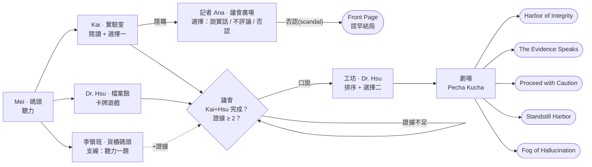

# Innovation Harbor（SDG 9-1）：故事收斂與數據收集報告

日期：2026-10-15 ｜ 分支：`company/story-nodes` ｜ 作者：公司端 AI ｜ 給：使用者、老師、接手的 AI

## 1. 故事怎麼收斂

第一章有 **8 個 NPC 節點**，其中 2 個是支線（李領班、記者 Ana），1 個會把人退回（議會）。玩家在 Mei 之後可以任意順序找 Kai、Dr. Hsu、李領班；所有路線最後都經過議會 → 工坊 → 劇場，由四個變數決定六種結局之一。

### 變數

| 變數 | 來源 | 用途 |
|---|---|---|
| `integrity` 誠信 | 選擇一（+2/+1/−2）、記者（+2/−1/−2）、選擇二（+2/0/−2） | 最佳結局門檻 ≥ 3 |
| `evidence` 證據 | Kai 陪查或通報 +1、Dr. Hsu +1、李領班答對 +1 | 議會門檻 ≥ 2；三個來源可觸發 The Evidence Speaks |
| `kai` | help / report / hide | 隱瞞開啟記者節點；影響議會、Dr. Hsu 的台詞 |
| `reporter` / `scandal` | told / silent / denied | 否認 → 到議會時提早結局 |
| `approach` | verify / ban / trust | 決定結局大類 |
| 各關星數 | 聽力、閱讀、卡牌、口說、排序、發表（0–3，口說可能「待老師評分」或「未完成」） | 平均星數 ≥ 2.3 才有最佳結局 |

### 結局判定（由上往下第一個符合的）

1. **Front Page**（提早）：對記者否認後走到議會。
2. **Fog of Hallucination**：選擇二「照單全收」，或「隱瞞」且沒選「查證」。
3. **Standstill Harbor**：選擇二「全面禁用」。
4. **Harbor of Integrity**：查證 ＋ 誠信 ≥ 3 ＋ 證據 ≥ 2 ＋ 平均星數 ≥ 2.3。
5. **The Evidence Speaks**：查證 ＋ 證據 = 3 ＋ 誠信 ≥ 1（發表不穩但證據齊全）。
6. **Proceed with Caution**：其餘。

## 2. 每個節點收集什麼數據

所有紀錄都是「學習事件」（Learning Log），正式版會寫入後端的 `learning_events` 表；目前只存在瀏覽器。

| 節點 / 活動 | 事件 | 欄位 |
|---|---|---|
| 所有對話 | `story.line`、`story.replay`、`hint.zh` | 誰說的、是否重聽、是否開中文提示 |
| 選擇 | `story.choice` | 選項、誠信變化 |
| 聽力（Mei、李領班） | `listen.play`、`listen.answer` | 播放次數、每個空格錯幾次、漏掉的目標字彙 |
| 閱讀（Kai） | `read.match`、`read.find` | 配對錯誤、找字錯誤、閱讀秒數 |
| 卡牌（Dr. Hsu，正式卡牌遊戲） | `cardgame.open`、`card.done`（＋卡牌遊戲自己送 `/game/pk-result`） | 錯誤、重播、秒數；錯誤數 > 卡片數標「可能在猜」 |
| 口說（議會） | `speak.demo`、`speak.attempt`、`speak.record`、`speak.skip` | 每次嘗試的覆蓋率、漏念單字、是否改錄音給老師、是否略過 |
| 排序（工坊） | `seq.done` | 錯誤次數 |
| 發表（劇場） | `pk.slide`、`pk.record`、`pk.skip` | 每張投影片覆蓋率、整段錄音、是否略過 |
| 節點流程 | `node.start`、`node.done`、`objective.pick`、`move` | 走訪順序、每個節點當時可選的節點、被退回的次數、是否用 Skip |
| 世界互動 | `story.overhear`、`portal.touch`、`safety.hit`、`drive.enter`/`drive.exit`/`drive.bump` | 偷聽到的提示、碰玻璃牆、被車撞、開車時間與碰撞 |
| 結局 | `ending` | 結局、平均星數、誠信、證據、完整路線 |

## 3. 後台可以算出的指標

| 類型 | 指標 |
|---|---|
| 成績 | 各關星數、平均星數、口說覆蓋率、待老師評分的錄音清單 |
| 診斷 | 全班漏念／漏聽最多的目標字彙、重播次數分布、卡牌「可能在猜」比例、閱讀時間 vs 正確率 |
| 行為 | 走訪順序（先找誰）、支線完成率、被議會退回的比例、中文提示使用率、每關停留時間 |
| 故事 | 六種結局的分布、誠信／證據分布、隱瞞路線比例 |
| 安全與探索（遊戲設計用） | 被車撞次數、開車時間、跳躍次數、偷聽次數 |

## 4. 目前限制

- 數據只在瀏覽器，重新整理即消失；後端事件 API 尚未做。
- 口說三層中「雲端發音評分」尚未接；無麥克風時改錄音或略過。
- 9-2、9-3 尚未實作（玻璃牆後只有剪影）。
